# Introductie

AssetTrack is een gratis webapplicatie om ICT-apparatuur te registreren: Chromebooks,
laptops, digiborden, printers, netwerkapparatuur en alles wat een school of kleine
organisatie verder in huis heeft. Je ziet per school en per lokaal wat er staat, bij wie
het in gebruik is, wanneer de garantie afloopt en wanneer iets vervangen moet worden.

Alle schermafbeeldingen in deze handleiding komen uit de **demo-omgeving** van AssetTrack.
De stichting, scholen, personen en apparaten daarin zijn verzonnen.

## Wat kun je met AssetTrack?

- Apparaten registreren per locatie en per ruimte, met foto's en koppelingen tussen apparaten
- Garanties, afschrijving en vervangingsmomenten bewaken
- Honderden apparaten tegelijk importeren uit Excel (CSV)
- Labels met QR-code of streepjescode afdrukken en scannen met je telefoon
- Rapporten maken en exporteren naar CSV of PDF
- Handleidingen en storingsoplossingen vastleggen in een kennisbank
- Werken met meerdere scholen of locaties, elk met een eigen kleur
- Rechten per rol en per locatie instellen

## Begrippen

| Begrip | Betekenis |
|---|---|
| Organisatie | Het bestuur of de stichting, bijvoorbeeld *Stichting Onderwijs Lindewaard*. |
| Locatie | Een school of vestiging, bijvoorbeeld *OBS De Zonnewijzer*. |
| Ruimte | Een lokaal, kantoor of andere plek binnen een locatie, bijvoorbeeld *Groep 5* of *Chromebookkar 1*. |
| Asset | Eén apparaat met een uniek assetnummer, bijvoorbeeld *AT-00031*. |
| Soort | Het type apparaat: Chromebook, Laptop, Touchscreen, Printer, enzovoort. |
| Status | In gebruik, Beschikbaar, In reparatie, Buiten gebruik of Afgevoerd. |

# Inloggen en aan de slag

## Inloggen

1. Open het adres van AssetTrack in je browser, bijvoorbeeld *https://mijnict.jouwschool.nl*.
2. Vul je gebruikersnaam of e-mailadres en je wachtwoord in.
3. Klik op **Inloggen**.

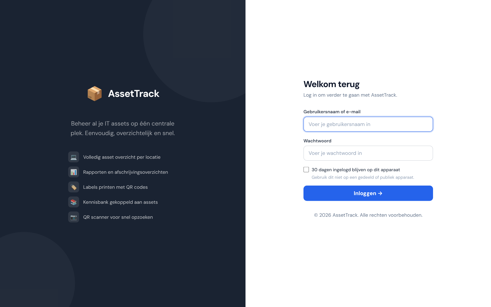{width=100%}

Je blijft ingelogd zolang je actief bent; na 8 uur zonder activiteit word je automatisch
uitgelogd. Vink **30 dagen ingelogd blijven op dit apparaat** aan als je op je eigen
laptop of telefoon werkt. Doe dat niet op een gedeelde of openbare computer.

## Een locatie kiezen

Heb je toegang tot meer dan één locatie, dan kies je na het inloggen met welke locatie je
wilt werken. Elke kaart laat zien hoeveel apparaten er zijn, hoeveel er in gebruik zijn en
hoeveel er beschikbaar zijn. Klik op **Deze locatie kiezen**.

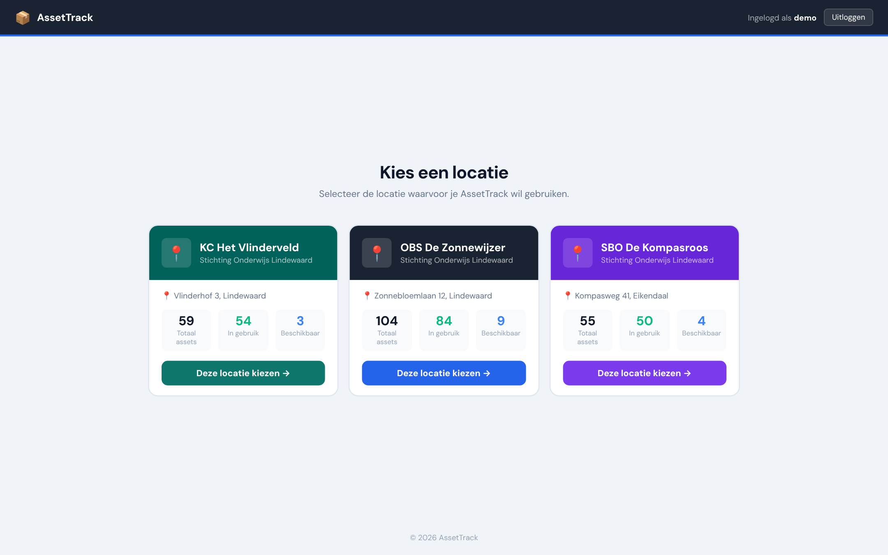{width=100%}

Heb je maar één locatie, dan sla je deze stap over en kom je direct op het dashboard.

## Wisselen van locatie

De naam van de actieve locatie staat linksboven in de menubalk. Klik erop om naar een
andere locatie te gaan. In hetzelfde menu vind je ook:

- **Alle locaties doorzoeken** — zoeken over alle scholen tegelijk (zie *Zoeken over alle locaties*).
- **Locatie-overzicht** — terug naar de kaarten met de aantallen per locatie.

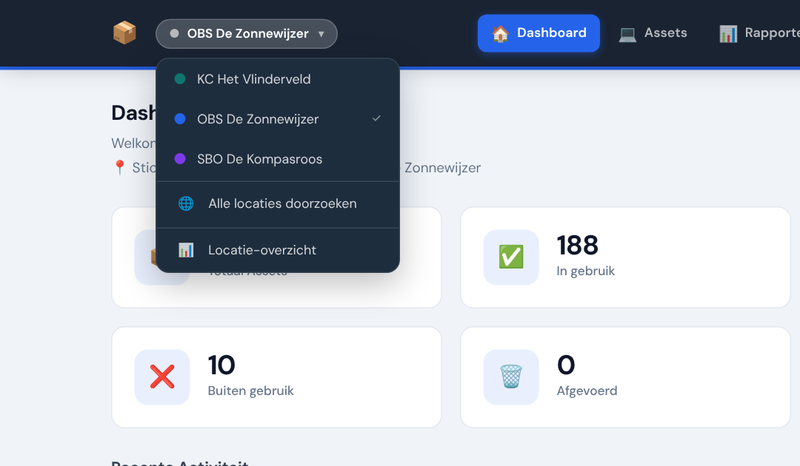{width=60%}

## Je eigen profiel

Klik rechtsboven op je avatar voor **Mijn profiel** en **Uitloggen**.

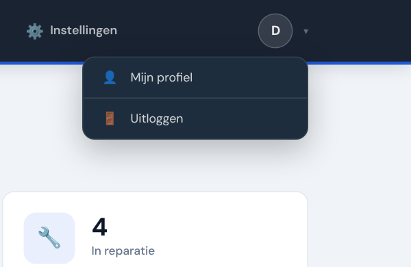{width=40%}

Bij **Mijn profiel** wijzig je je naam, e-mailadres, wachtwoord en profielfoto. Voor het
wijzigen van je e-mailadres of wachtwoord vul je ter controle je huidige wachtwoord in.
Je gebruikersnaam kan alleen een beheerder aanpassen.

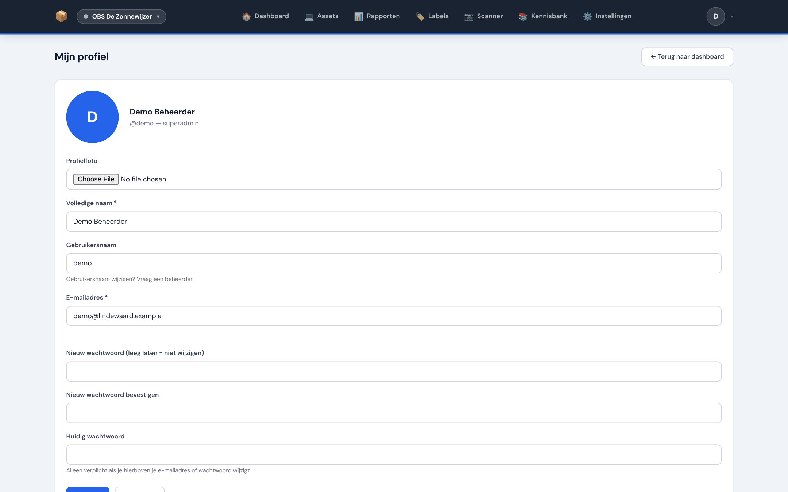{width=100%}

# Dashboard

Het dashboard geeft in één oogopslag de stand van zaken. Klik op een kaart om direct de
bijbehorende lijst met apparaten te openen.

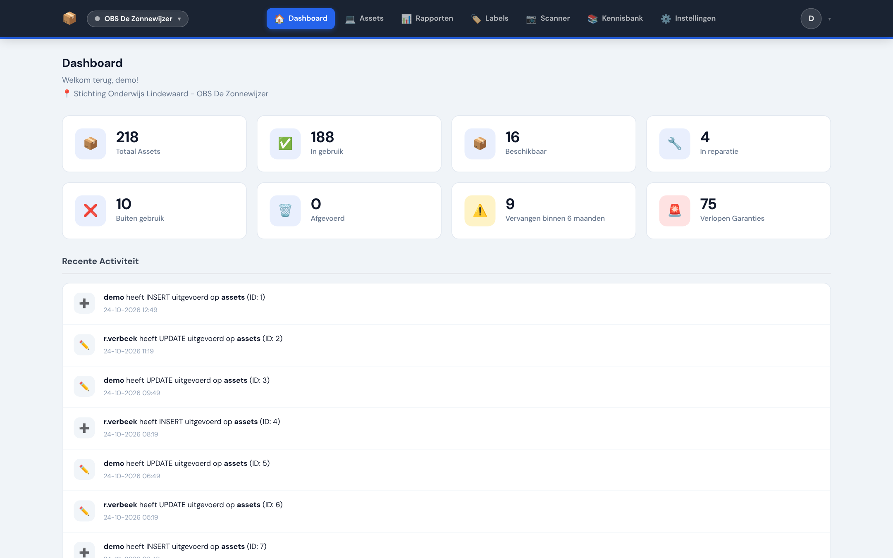{width=100%}

| Kaart | Betekenis |
|---|---|
| Totaal assets | Alle geregistreerde apparaten (voor een superadmin: van alle locaties). |
| In gebruik / Beschikbaar / In reparatie / Buiten gebruik / Afgevoerd | Aantal apparaten per status. |
| Vervangen binnen 6 maanden | Apparaten waarvan de vervangingsdatum binnen een half jaar valt. |
| Verlopen garanties | Apparaten waarvan de garantie is verlopen. |

Onder de kaarten staat **Recente activiteit**: wie wat heeft toegevoegd of gewijzigd.

# Apparaten (assets)

## Het overzicht

Kies **Assets** in het menu. Je ziet alle apparaten van de actieve locatie. Klik op een
assetnummer of op **Bekijken** voor de details, of op het potloodje om te bewerken.

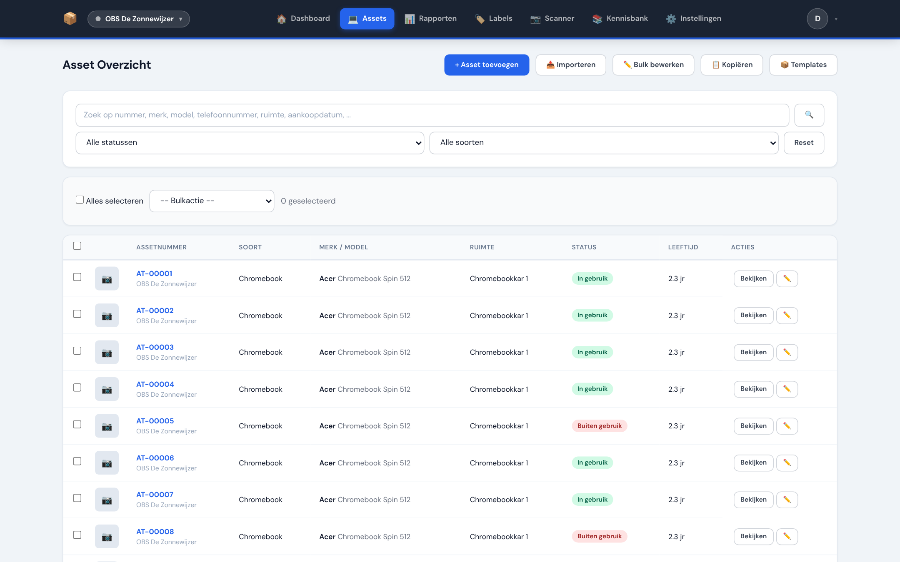{width=100%}

Bovenaan staan de knoppen **+ Asset toevoegen**, **Importeren**, **Bulk bewerken**,
**Kopiëren** en **Templates**. Onderaan kies je hoeveel apparaten er per pagina staan.

## Zoeken en filteren

De zoekbalk doorzoekt bijna alle velden: assetnummer, merk, model, serienummer, ruimte,
gebruiker, MAC- en IP-adres, telefoonnummer, opmerkingen en datums. Zoek bijvoorbeeld op
*Groep 5* voor alles in dat lokaal, of op *2023* voor alles wat in 2023 is gekocht.
Combineer de zoekterm met de filters voor status en soort.

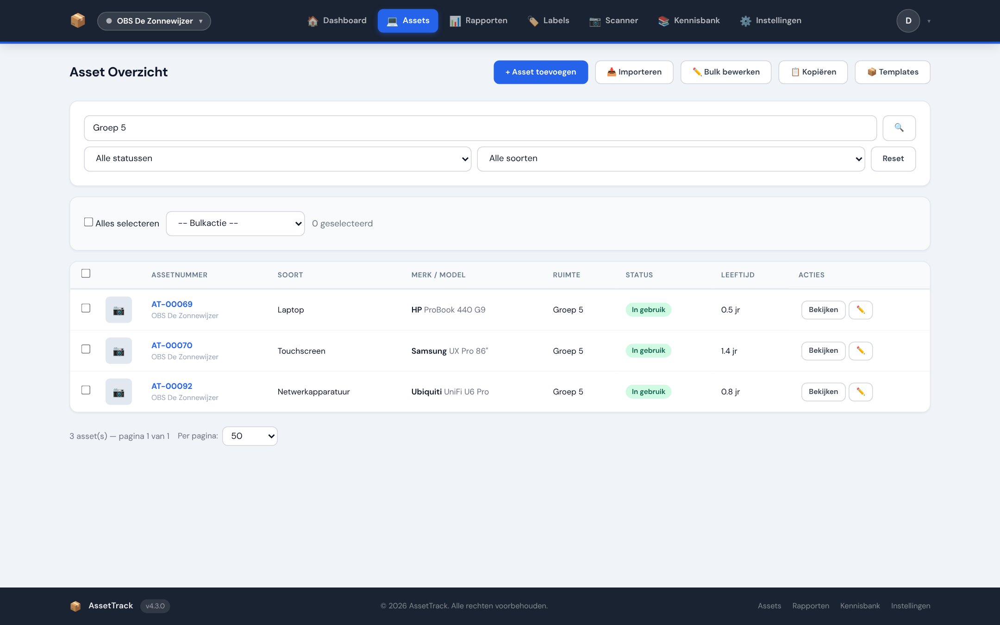{width=100%}

Ga je vanaf een apparaat terug met **← Terug**, dan kom je weer uit op je laatste
zoekopdracht.

## Een apparaat bekijken

De detailpagina toont alle gegevens, gegroepeerd in Algemeen, Gebruik, Financieel &
Garantie, Netwerk, Hardware en eventuele eigen velden. Een rode melding bovenaan wijst
op een verlopen garantie of een naderende vervanging.

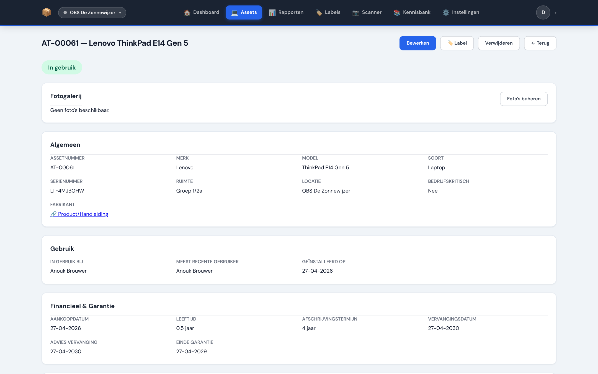{width=100%}

Met de knoppen rechtsboven kun je het apparaat **bewerken**, een **label** afdrukken of
het **verwijderen**. Onder **Foto's beheren** voeg je foto's toe, ook rechtstreeks met de
camera van je telefoon. Grote foto's worden automatisch verkleind.

Kennisbankartikelen die bij de soort of het merk van het apparaat horen, verschijnen
automatisch op de detailpagina.

## Een apparaat toevoegen

1. Klik in het overzicht op **+ Asset toevoegen**.
2. Vul minimaal **Merk** en **Model** in. Laat het assetnummer leeg, dan krijgt het
   apparaat automatisch het volgende nummer (AT-00001, AT-00002, …).
3. Kies de ruimte, de status en vul in wat je weet: serienummer, aankoopdatum,
   garantie, netwerkgegevens, hardware.
4. Koppel het apparaat eventueel meteen aan andere apparaten (zie *Gekoppelde apparaten*).
5. Klik op **Asset opslaan**.

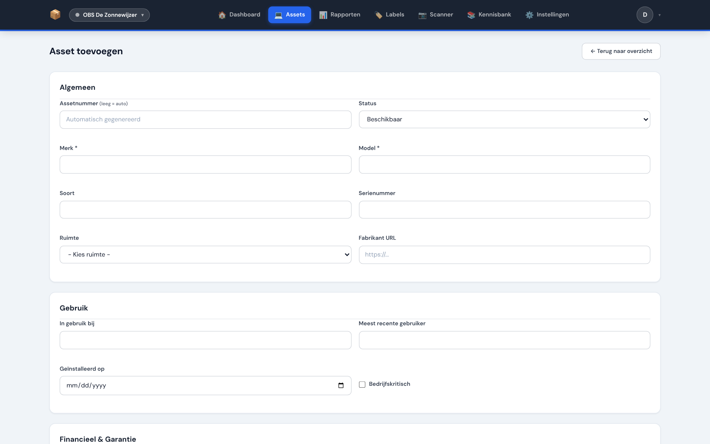{width=100%}

> **Tip:** een MAC-adres mag je invoeren als `02:5A:00:AA:BB:CC`, `02-5A-00-AA-BB-CC` of
> `025A00AABBCC`. AssetTrack slaat het altijd op in dezelfde vorm.

> **Tip:** werk je vaak met hetzelfde type apparaat? Begin dan vanuit een *template*
> (zie hoofdstuk Templates), dan zijn merk, model, afschrijving en besturingssysteem al
> ingevuld.

## Bewerken, verplaatsen en afvoeren

Klik op **Bewerken** om gegevens aan te passen. Heb je toegang tot meerdere locaties, dan
kun je het apparaat hier ook naar een andere school verplaatsen: kies de nieuwe
**Locatie** en daarna de ruimte.

Een apparaat dat de deur uitgaat, kun je beter de status **Afgevoerd** geven dan
verwijderen; dan blijft de geschiedenis bewaard. Echt verwijderen kan via **Verwijderen**
op de detailpagina (alleen met het recht *Assets verwijderen*).

## Gekoppelde apparaten

Koppel apparaten die bij elkaar horen, bijvoorbeeld twee monitoren aan een pc. Klik op de
detailpagina bij **Gekoppelde assets** op **+ Koppeling toevoegen**, zoek het andere
apparaat en kies het soort koppeling (randapparaat, onderdeel van, vervanging van of
netwerkkoppeling). Met het rode kruisje maak je een koppeling weer los; dat kan vanaf
beide apparaten.

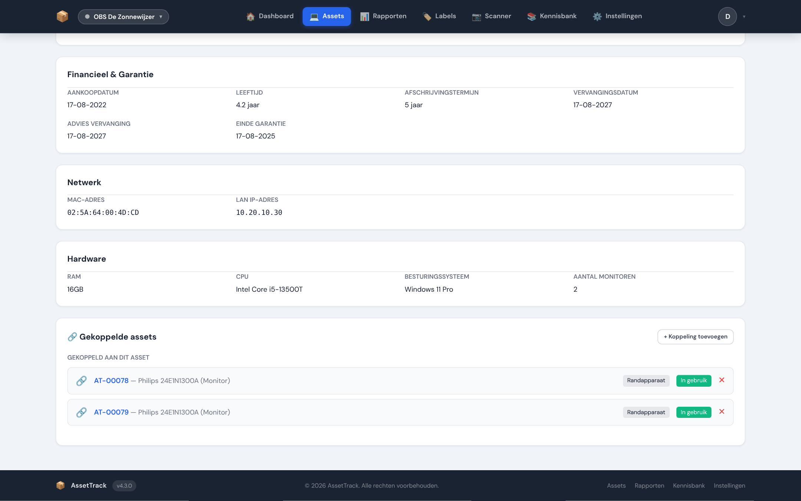{width=100%}

## Zoeken over alle locaties

Via het locatiemenu → **Alle locaties doorzoeken** zoek je in één keer in alle scholen
waar je toegang toe hebt. Handig als je niet weet waar een apparaat staat. Vanuit de
resultaten kun je het apparaat bekijken, bewerken of verwijderen.

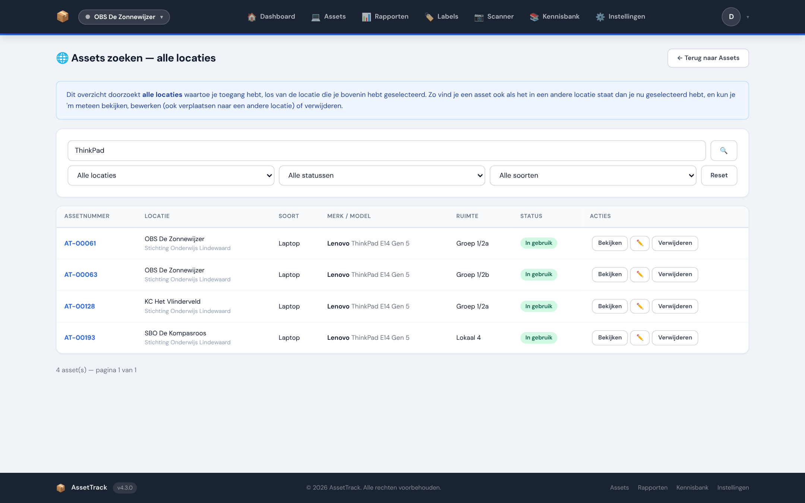{width=100%}

## Velden kopiëren naar andere apparaten

Met **Kopiëren** neem je gegevens van één apparaat (de bron) over op een reeks andere
apparaten, bijvoorbeeld de besturingssysteemversie of de garantiedatum van een hele
levering.

# Templates

Een template is een standaardprofiel voor een type apparaat, bijvoorbeeld *Chromebook
leerling*: soort, merk, model, afschrijvingstermijn, garantieduur, besturingssysteem en
fabrikantlink. Ga naar **Assets → Templates** en klik bij een template op **+ Nieuw asset**:
het formulier opent met die velden al ingevuld. Met **Toepassen** zet je de gegevens van een
template op bestaande apparaten van die soort; je kiest zelf welke velden en apparaten.

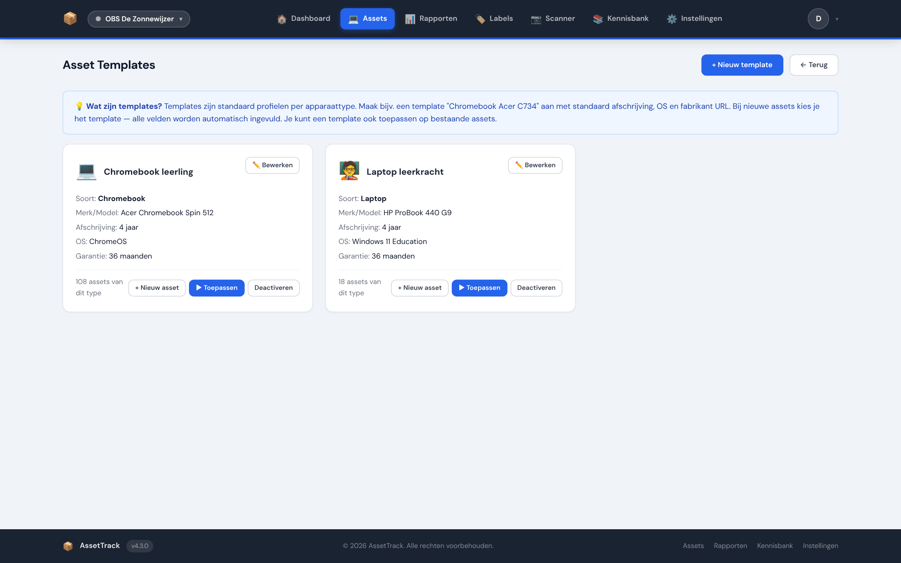{width=100%}

# Bulk bewerken

Met **Bulk bewerken** pas je één veld aan voor veel apparaten tegelijk, bijvoorbeeld de
status van een hele Chromebookkar.

1. **Stap 1 — Filter:** zoek op tekst, merk, soort, ruimte of status. Met **Filter op
   kolom** filter je op elk veld, ook op eigen velden; vink **Alleen leeg / niet ingevuld**
   aan om bijvoorbeeld alle apparaten zonder serienummer te vinden.
2. **Stap 2 — Selecteer:** vink de apparaten aan (of **Alles selecteren**). Zijn er meer
   dan 200 resultaten, klik dan op **Toon alle resultaten**.
3. **Stap 3 — Actie:** kies het veld en de nieuwe waarde, of kies **Assets verwijderen**
   (alleen met het recht om te verwijderen). Klik op **Wijziging doorvoeren**.

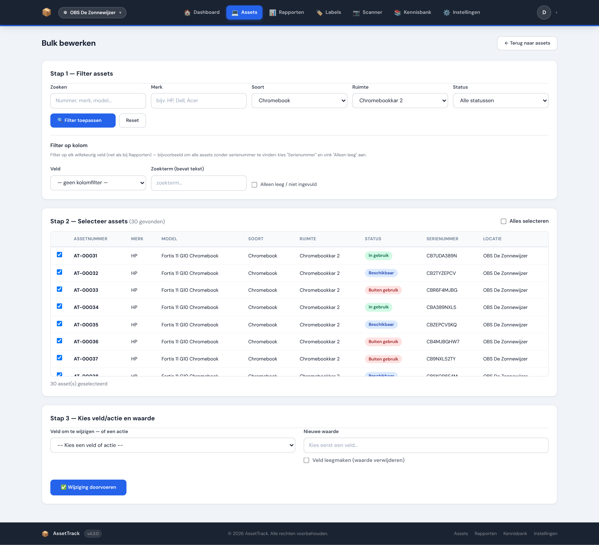{width=100%}

In het gewone assetoverzicht kun je ook een paar apparaten aanvinken en via **Bulkactie**
de status of locatie wijzigen.

# Importeren uit Excel (CSV)

Heb je al een lijst in Excel? Importeer die dan in één keer.

## Het bestand voorbereiden

- Eén rij per apparaat, met een kopregel met kolomnamen.
- Sla op als **CSV** (puntkomma of komma als scheidingsteken). Zowel "CSV UTF-8" als
  gewone "CSV" uit Excel werkt; accenten zoals in *Conciërge* blijven goed.
- Datums als **DD-MM-JJJJ**, bijvoorbeeld 15-08-2024.
- Maximaal 500 rijen en 2 MB per bestand; splits grotere lijsten op.
- Laat het assetnummer leeg voor automatische nummering.
- Op het importscherm kun je een voorbeeldbestand downloaden (**import_template.csv**).

## Stap 1 — Uploaden

Kies de locatie waar de apparaten bij horen, het bestand en het scheidingsteken.

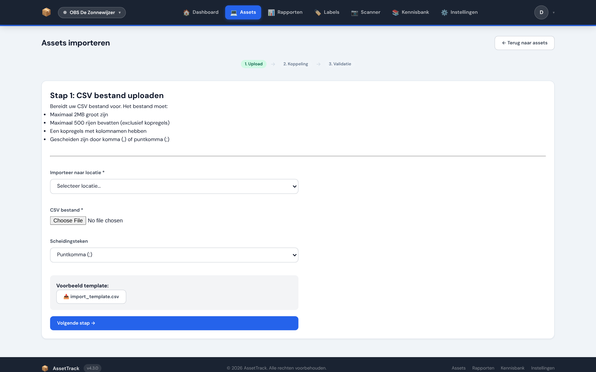{width=100%}

## Stap 2 — Kolommen koppelen

Je ziet de eerste rijen van je bestand. Kies per kolom bij welk veld van AssetTrack die
hoort, of laat **Niet importeren** staan. Ook eigen velden staan in de lijst.

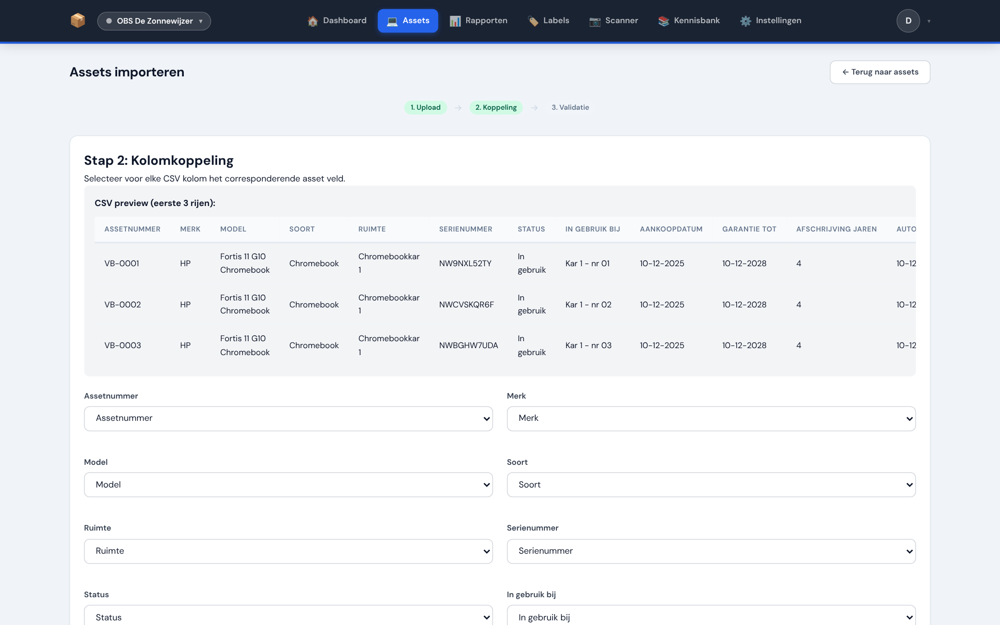{width=100%}

## Stap 3 — Controleren en importeren

AssetTrack controleert elke rij voordat er iets wordt opgeslagen:

- **Geldig** — wordt geïmporteerd.
- **Waarschuwing** — wordt geïmporteerd, maar er is iets aangepast of overgeslagen
  (bijvoorbeeld een onleesbare datum).
- **Fout** — wordt niet geïmporteerd, bijvoorbeeld omdat het serienummer of assetnummer
  al bestaat, ook als het dubbel in hetzelfde bestand staat.

Klik op **Importeren** om de geldige rijen op te slaan. Nieuwe ruimtes en merken worden
automatisch aangemaakt.

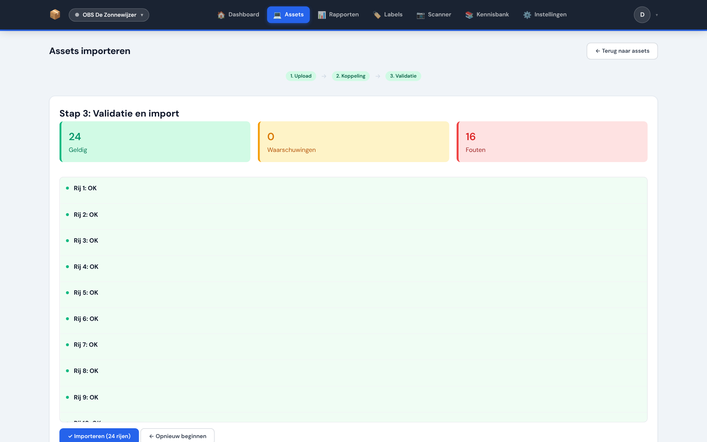{width=100%}

# Labels afdrukken

Op elk apparaat hoort een label met assetnummer en QR-code of streepjescode. Scan je de
code, dan opent AssetTrack direct de detailpagina van dat apparaat.

1. Kies **Labels** in het menu en filter op status, soort of ruimte.
2. **Stap 1:** vink de apparaten aan (of **Alles selecteren**).
3. **Stap 2:** kies het formaat van je labelvel of labelprinter.
4. **Stap 3:** kies QR-code of streepjescode en welke extra gegevens op het label komen.
5. Klik op **Labels genereren**. Je krijgt een voorbeeld; kies **Afdrukken** of
   **PDF exporteren**.

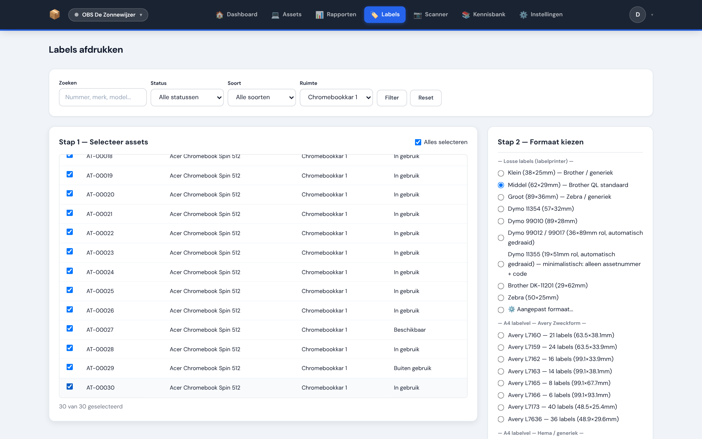{width=100%}

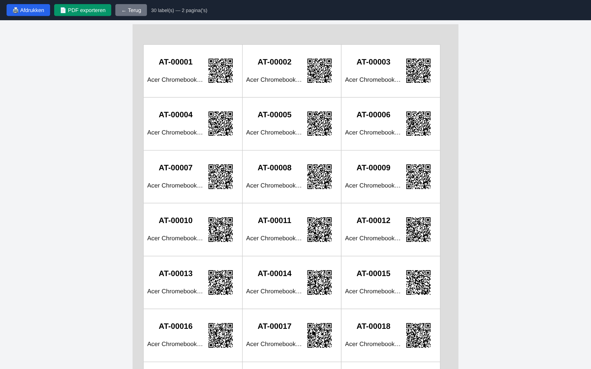{width=100%}

| Groep | Formaten |
|---|---|
| Labelprinters | Brother (38×25, 62×29, DK-11201), Zebra (50×25, 89×36), Dymo 11354, 99010, 99012/99017 en 11355, of een eigen formaat in mm |
| Avery A4 | L7160, L7159, L7162, L7163, L7165, L7166, L7173, L7636 |
| Generiek A4 | 10, 21, 24, 40 of 65 labels per vel (65 per vel = Avery J8651) |
| Pocketprinter | Fichero Mini 5836 (30×14 mm): losse PNG-afbeeldingen om in de app van de printer te openen |

Op de kleinste formaten (Dymo 11355, A4 65 per vel, Fichero) staan alleen het assetnummer
en de code, zo groot mogelijk, zodat de code goed scanbaar blijft.

> **Tip:** komt een label op zijn kant uit de printer, zet dan **Label 90° gedraaid
> afdrukken** aan. AssetTrack onthoudt je laatste keuzes.

# Scanner en app op je telefoon

Met **Scanner** in het menu gebruik je de camera van je telefoon of tablet om labels te
scannen. Klik op **Scanner starten**, geef toestemming voor de camera en richt op de code.
AssetTrack opent meteen het juiste apparaat. De scanner leest QR-codes én streepjescodes.

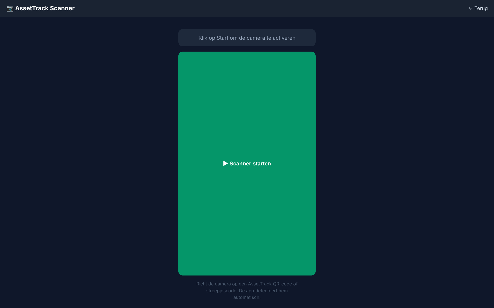{width=100%}

Scan je een label met de gewone camera van je telefoon, dan opent de browser de
detailpagina; ben je nog niet ingelogd, dan kom je na het inloggen alsnog bij het apparaat.

AssetTrack werkt ook goed op een telefoon. Het menu zit dan achter de knop ☰.

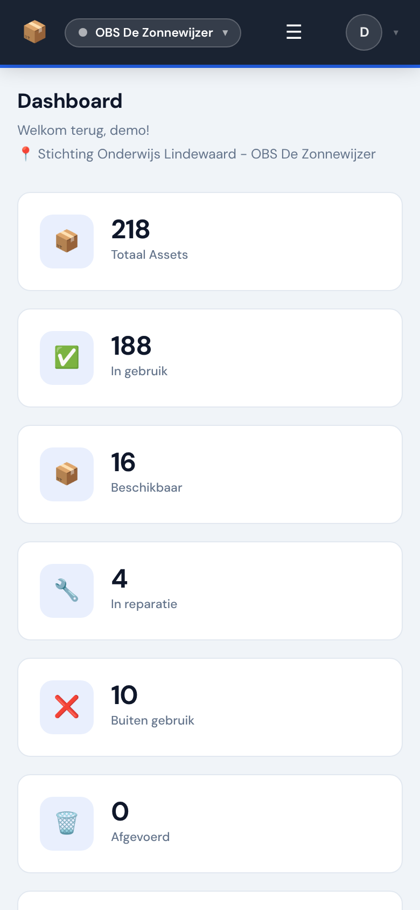{width=35%}
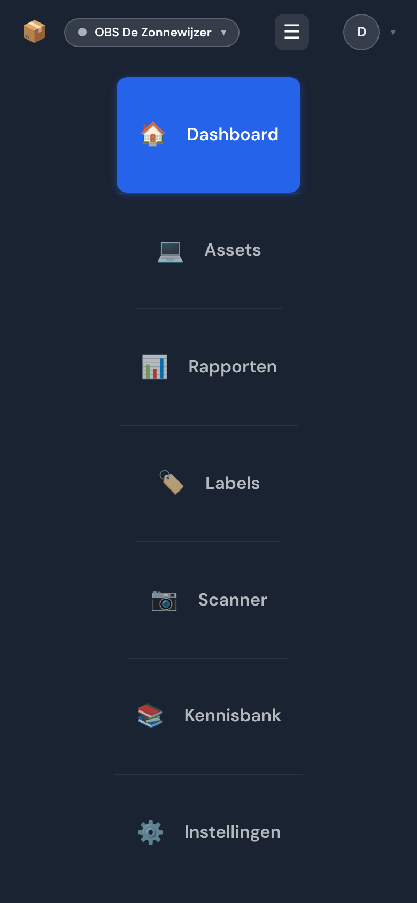{width=35%}

**Als app installeren:** open AssetTrack op je telefoon en kies
*iPhone/iPad:* Safari → Deel → *Zet op beginscherm*, of *Android:* Chrome → menu →
*App installeren*. AssetTrack staat dan als icoon tussen je apps.

# Rapporten

Kies **Rapporten** in het menu en open een van de acht rapporten.

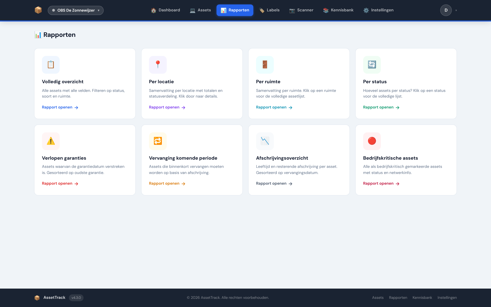{width=100%}

| Rapport | Inhoud |
|---|---|
| Volledig overzicht | Alle apparaten met alle velden. |
| Per locatie | Aantallen per school, met doorklikken naar de details. |
| Per ruimte | Aantallen per lokaal, met doorklikken naar de details. |
| Per status | Aantallen per status. |
| Verlopen garanties | Apparaten met een verlopen garantie, oudste eerst. |
| Vervanging komende periode | Apparaten die binnenkort aan vervanging toe zijn. |
| Afschrijvingsoverzicht | Leeftijd en afschrijving per apparaat. |
| Bedrijfskritische assets | Alles wat als bedrijfskritisch is gemarkeerd. |

Filter op locatie (ook **Alle mijn locaties**), status, soort, ruimte of op de inhoud van
een eigen veld en klik op **Toepassen**. Een assetnummer in een rapport is aanklikbaar.

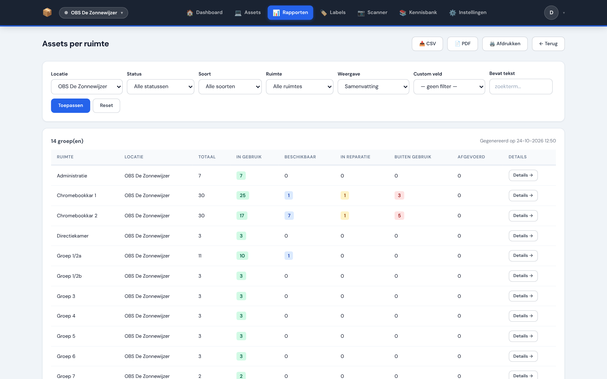{width=100%}

Onder **Extra velden op dit rapport** kies je zelf welke kolommen er bij komen, ook je
eigen velden. AssetTrack onthoudt je keuze per rapport.

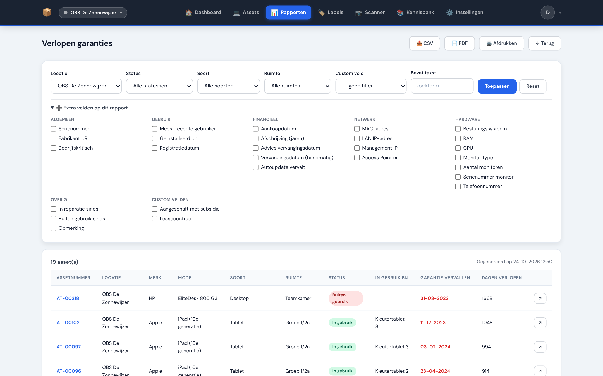{width=100%}

Met **CSV** open je het rapport in Excel, met **PDF** krijg je een nette PDF waarin alle
gekozen kolommen passen, en **Afdrukken** drukt de pagina direct af.

# Kennisbank

In de kennisbank leg je handleidingen en oplossingen vast: hoe reset je een Chromebook,
wat te doen bij een papierstoring. Artikelen staan in categorieën en zijn doorzoekbaar.

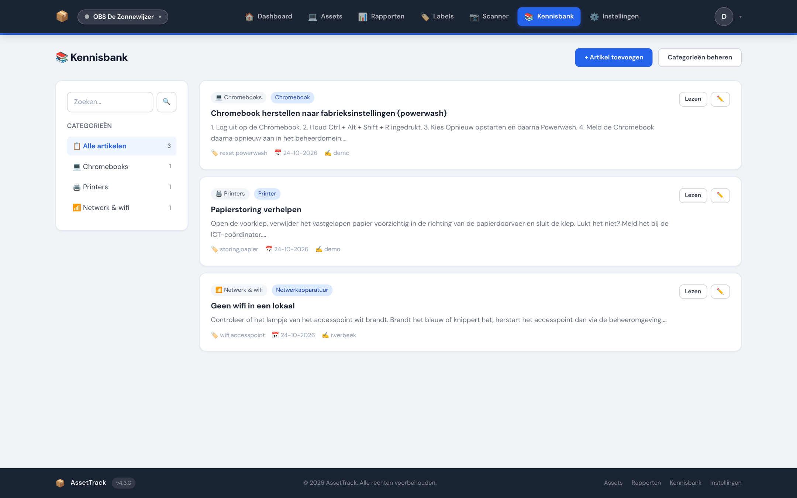{width=100%}

1. Klik op **+ Artikel toevoegen**.
2. Vul titel, categorie en inhoud in; voeg eventueel trefwoorden en een link naar de
   handleiding van de fabrikant toe.
3. Koppel het artikel aan een **soort** (bijvoorbeeld Chromebook), een **merk** of aan
   specifieke apparaten. Het artikel verschijnt dan automatisch op de detailpagina van
   die apparaten.

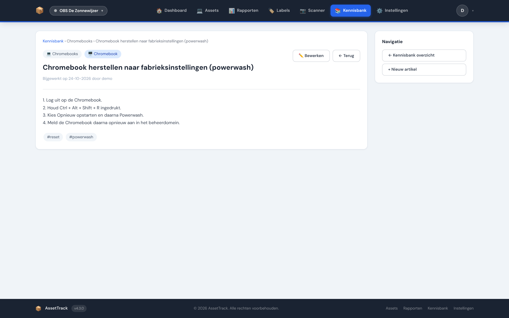{width=100%}

Met **Categorieën beheren** maak je eigen categorieën met een icoon.

# Gebruikers en rechten

Gebruikersbeheer vind je onder **Instellingen → Gebruikers**.

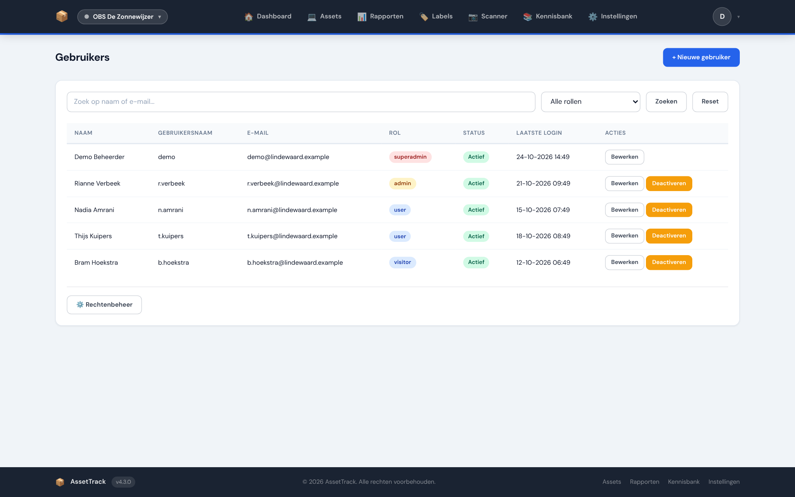{width=100%}

| Rol | Standaardrechten |
|---|---|
| Superadmin | Alles, op alle locaties. Kan niet worden beperkt. |
| Admin | Apparaten, import, labels, rapporten, kennisbank en gebruikers; geen systeeminstellingen. |
| Gebruiker | Apparaten bekijken, toevoegen en bewerken, labels afdrukken, scannen. |
| Bezoeker | Alleen bekijken. |

## Een gebruiker toevoegen

1. Klik op **+ Nieuwe gebruiker**.
2. Vul naam, gebruikersnaam, e-mailadres en een wachtwoord (minimaal 8 tekens) in.
3. Kies de rol.
4. Kies bij **Locatie rechten** per school of de gebruiker mag kijken en/of bewerken.
5. Klik op **Gebruiker aanmaken**.

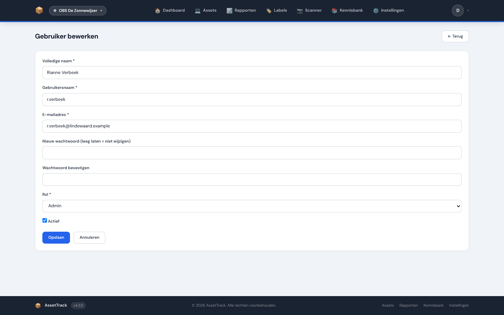{width=100%}

Iemand die uit dienst gaat, kun je **deactiveren**; zijn naam blijft dan zichtbaar in de
geschiedenis. Een vergeten wachtwoord stelt een beheerder opnieuw in via **Bewerken**.

## Rechtenbeheer

Via **Rechtenbeheer** stel je per rol in wat die mag: assets bekijken, toevoegen,
bewerken, verwijderen of importeren, scannen, labels afdrukken, rapporten bekijken en
exporteren, de kennisbank lezen of beheren, gebruikers en instellingen beheren.
Wijzigingen gelden direct voor iedereen met die rol.

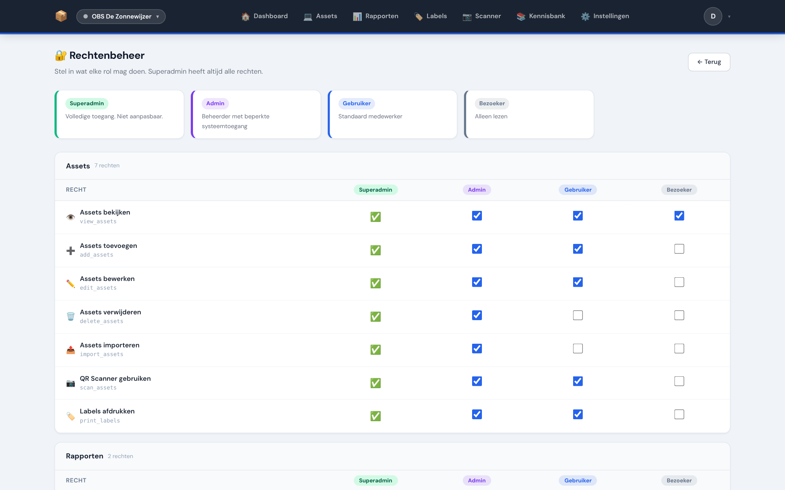{width=100%}

# Instellingen

Onder **Instellingen** staat alles wat je één keer inricht.

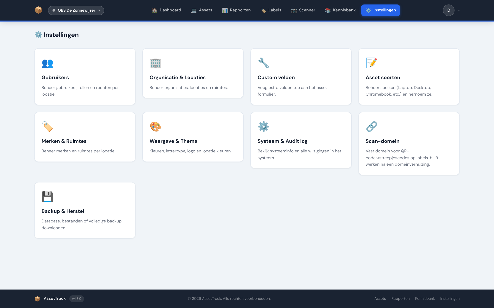{width=100%}

## Organisatie, locaties en ruimtes

Beheer de organisatie, de scholen (met adres en logo) en per school de ruimtes.
Een ruimte, locatie of organisatie kun je alleen verwijderen als er niets meer aan
gekoppeld is; AssetTrack laat zien wat er nog in staat.

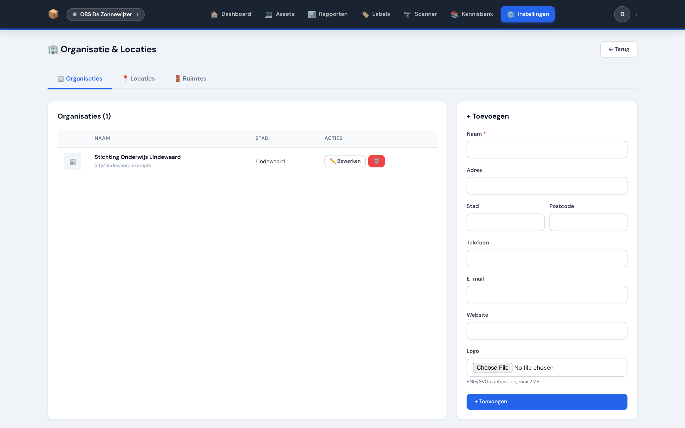{width=100%}

> **Let op:** de ruimte van een apparaat wordt op naam opgeslagen. Hernoem je een ruimte,
> controleer dan in het assetoverzicht of de apparaten nog in de goede ruimte staan.

## Merken, soorten en eigen velden

- **Merken & Ruimtes** — de lijst met merken die je bij het invoeren ziet. Verkeerde
  merken (bijvoorbeeld na een mislukte import) kun je verwijderen; de apparaten zelf
  blijven ongewijzigd.
- **Asset soorten** — voeg soorten toe (Beamer, Camera, …) of hernoem ze; een nieuwe naam
  wordt bij alle bestaande apparaten doorgevoerd. Verwijderen kan alleen als een soort niet
  in gebruik is; deactiveren verbergt hem in de keuzelijsten.
- **Custom velden** — voeg eigen velden toe aan het apparaatformulier, bijvoorbeeld
  *Aangeschaft met subsidie* (ja/nee) of *Leasecontract* (tekst). Soorten: tekst, nummer,
  datum, keuzelijst, ja/nee, tekstvak, IP-adres en MAC-adres.

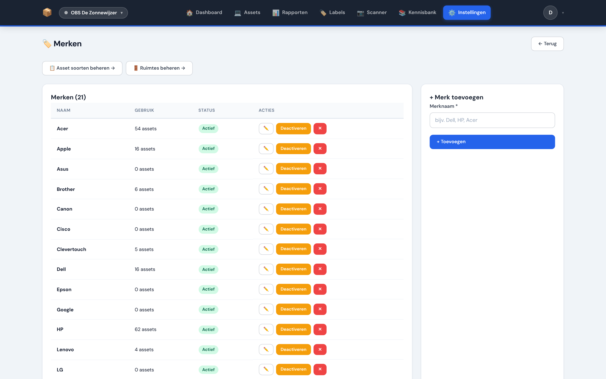{width=100%}

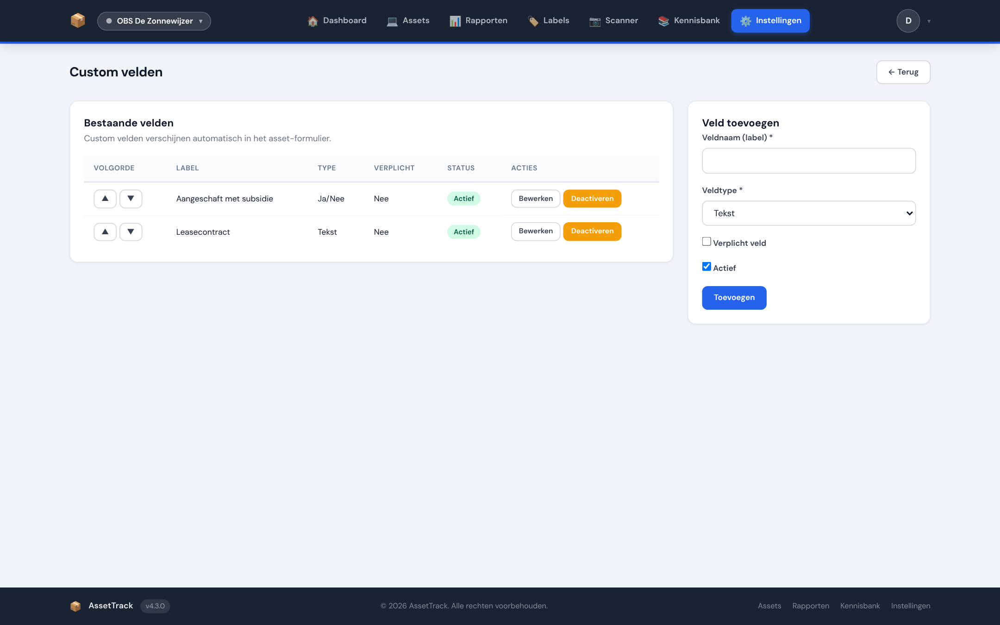{width=100%}

## Weergave en thema

Geef AssetTrack de uitstraling van je organisatie: naam, logo, kleuren (of een van de acht
paletten), lettertype en een eigen kleur per school. Rechts zie je direct een voorbeeld.

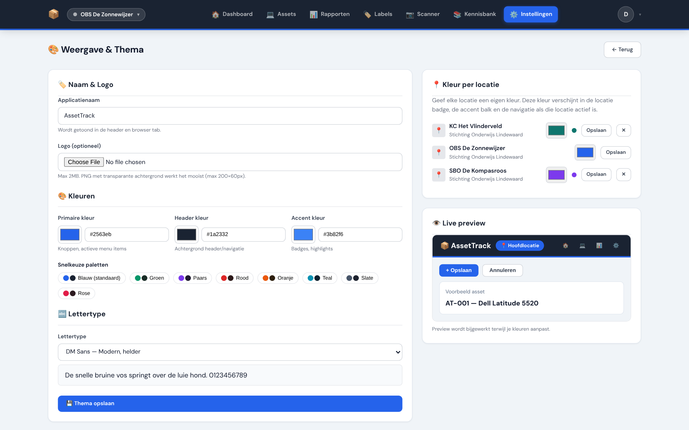{width=100%}

## Scan-domein

Labels die al geprint zijn, blijven werken als AssetTrack naar een ander webadres verhuist,
zolang je ze scant met de ingebouwde **Scanner**. Wil je dat nieuwe labels altijd naar een
vast adres verwijzen, vul dat adres dan hier in (alleen voor de superadmin).

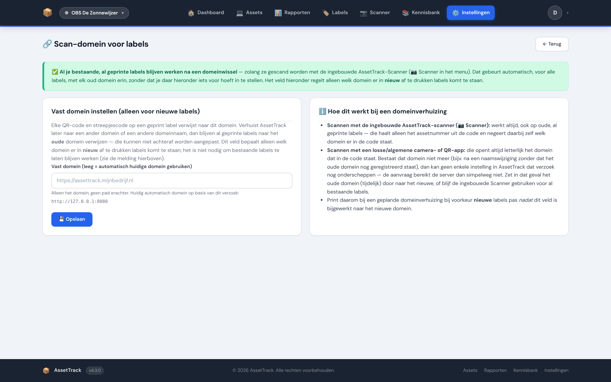{width=100%}

## Systeem, audit log en backup

- **Systeem & Audit log** toont de PHP- en databaseversie en wie wanneer wat heeft
  gewijzigd, te filteren per gebruiker.
- **Backup & Herstel** downloadt een backup van de database, van de bestanden of alles
  samen, met herstelinstructies. Bewaar backups op een veilige plek: ze bevatten de
  databasegegevens.

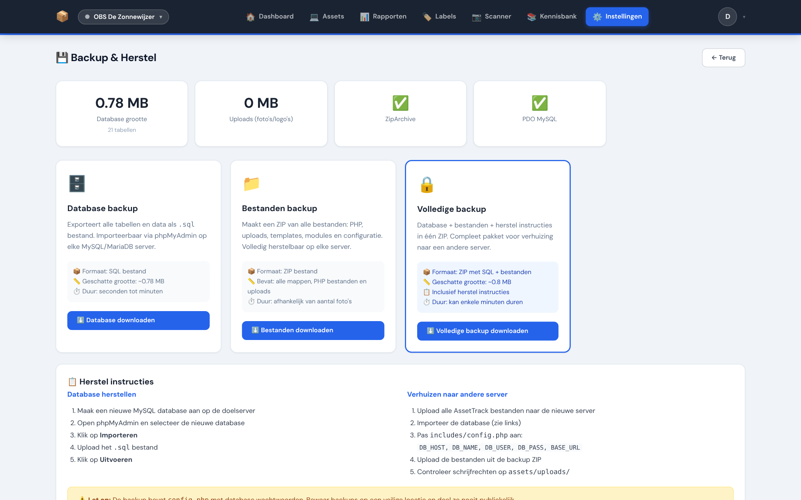{width=100%}

# Installatie en updates (voor beheerders)

## Nieuwe installatie

1. Maak in het paneel van je hostingpartij een MySQL/MariaDB-database aan en noteer
   hostnaam, databasenaam, gebruiker en wachtwoord.
2. Upload het installatiepakket (*assettrack-X.Y.Z.zip*) naar de webmap en pak het daar
   uit. Bij Strato gaat dat het makkelijkst via de File Manager.
3. Open *https://jouwdomein.nl/install/* en doorloop de vier stappen: database,
   beheerder, weergave en klaar.
4. De installatiewizard schakelt zichzelf daarna uit. Verwijder de map `install/` als die
   nog bestaat; AssetTrack waarschuwt onder *Systeem* zolang hij er staat.

Draait AssetTrack op een eigen subdomein (zoals *mijnict.jouwschool.nl*), laat het veld
voor de submap dan leeg.

## Updates

Een nieuwe versie zet je op de server met het deploy-script (`npm run deploy`) of door de
gewijzigde bestanden te uploaden. Database-aanpassingen gaan automatisch bij het eerste
bezoek na de update; je hoeft nooit zelf SQL uit te voeren. Je configuratie
(`includes/config.php`) en de geüploade foto's blijven altijd ongemoeid.
Het versienummer zie je linksonder in de voettekst.

# Veelgestelde vragen

**Ik ben mijn wachtwoord vergeten.**
Vraag een beheerder om via *Instellingen → Gebruikers → Bewerken* een nieuw wachtwoord in
te stellen.

**Ik word steeds uitgelogd.**
Vink bij het inloggen *30 dagen ingelogd blijven op dit apparaat* aan (niet op een
gedeelde computer).

**Mijn import geeft fouten.**
Controleer of het serienummer of assetnummer niet al bestaat, of datums als DD-MM-JJJJ
zijn ingevuld en of het juiste scheidingsteken is gekozen. Rijen met een waarschuwing
worden wel geïmporteerd.

**Een QR-code is niet te scannen.**
Kies een groter labelformaat of de minimalistische variant (alleen nummer en code) en
druk af op 100 % (niet "passend maken"). Op de kleinste formaten werkt een streepjescode
met een handscanner vaak beter.

**Ik zie een apparaat niet.**
Controleer welke locatie actief is (linksboven) of gebruik *Alle locaties doorzoeken*.
Mogelijk heb je geen rechten op die locatie; vraag dat aan je beheerder.

**Kan ik een organisatie, locatie, ruimte of merk verwijderen?**
Ja, als er niets meer aan gekoppeld is. Merken kun je altijd verwijderen; de apparaten
houden hun merknaam.

**Wat gebeurt er met mijn labels als AssetTrack naar een ander adres verhuist?**
Scannen met de ingebouwde Scanner blijft gewoon werken. Een losse camera-app opent het
oude adres; laat dat oude adres daarom doorverwijzen naar het nieuwe.
